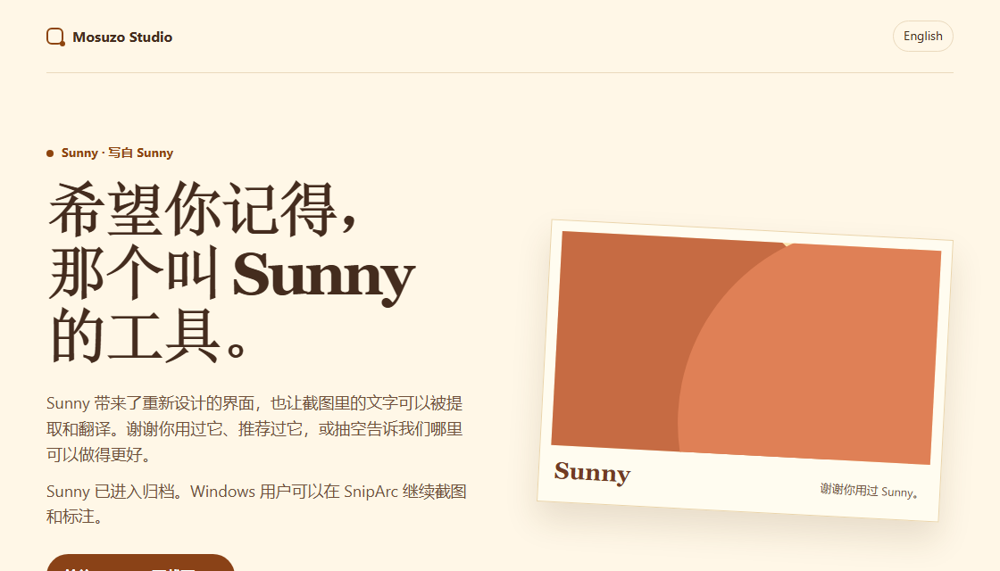
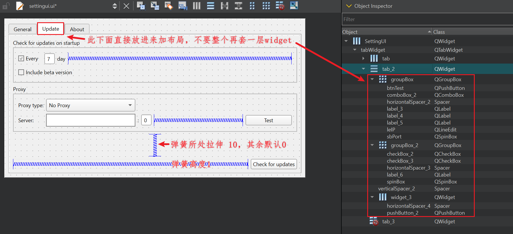
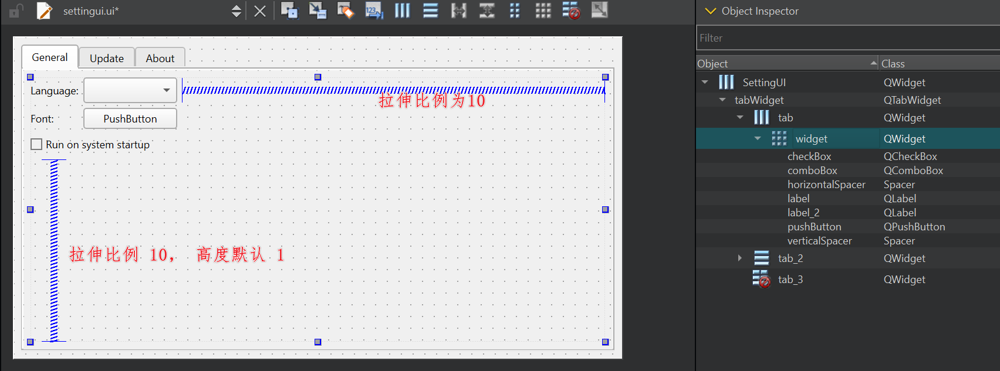
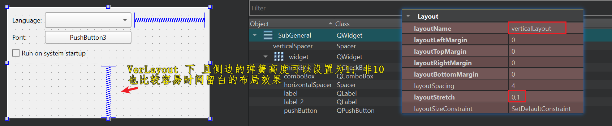
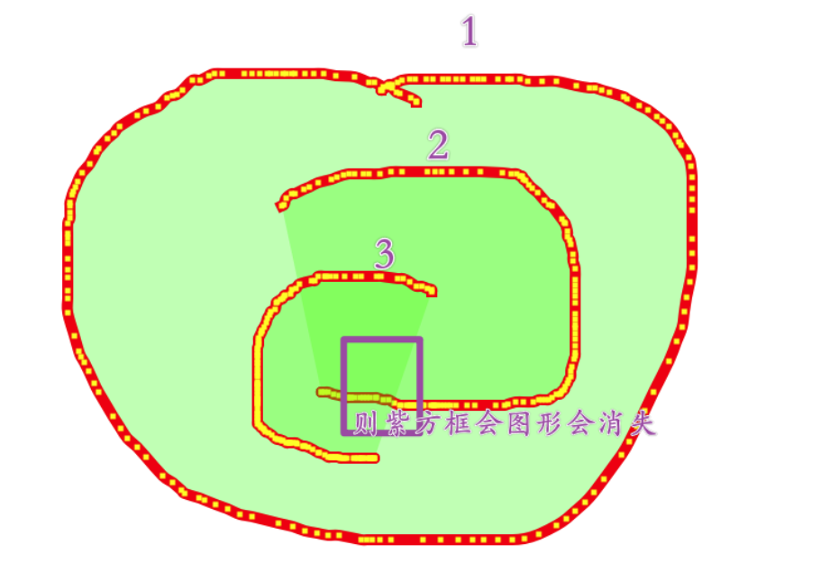

> [!IMPORTANT]
>  **Move to SnipArc**
>
> **November 28, 2026** · Switch to **SnipArc**, our next-generation screenshot and annotation app. We’ll continue to maintain and improve it.
>
> **[Download SnipArc](https://sniparc.mosuzo.com/)** · [Explore more from Mosuzo Studio](https://mosuzo.com/)

---

# Sunny

[Original project website](https://sunny.xmuli.tech/)

<a href="README.md">English</a> · <a href="README.zh_CN.md">简体中文</a>

         

> **Archived.** The 2.x generation brought offline OCR and image translation into the screenshot flow.
>
> Sunny **2.x** · Qt / C++ · Windows, macOS, Linux

## Overview

Sunny is the third generation: a redesigned screenshot tool that treats text inside images as part of the workflow. Select a region, extract the text, or translate it in place — without sending the image to a server.

The website and the original project history now live together in this repository, so the project page and the code archive stay in sync.

## Highlights

- Screenshot, annotation, pinning and editing
- Offline OCR for extracting text from images
- Image translation for 20+ languages
- Acrylic toolbars and rich-text annotations
- Redesigned UI/UX with seamless settings panels
- Listed in Microsoft Store, Deepin/UOS stores and Spark Store

## Historical screenshots

Select a screenshot to view the original.

### Sunny 2.x development archive

 

 

[Historical source README](https://github.com/SunnyCapturer/sunny-screenshot/blob/3c91d95/README.md)

## Status

Sunny is archived. On Windows, continue with **SnipArc**.

## Links

| | |
| --- | --- |
| **Website** | https://sunny.xmuli.tech/ |
| **Archive entry** | https://screenshot-archive.xmuli.tech/sunny/ |
| **GitHub** | https://github.com/XMuli/Sunny |
| **Tags** | https://github.com/XMuli/Sunny/tags |

## The screenshot series

ShotX → FLIPPED → Sunny → SunnyCapturer → SnipArc.  
[Full visual archive](https://screenshot-archive.xmuli.tech/)

## Contact

- **Mosuzo Studio** — https://mosuzo.com/
- **GitHub** — https://github.com/XMuli
- **QQ group** — 418103279 · https://qm.qq.com/q/ff0xkauRdm
